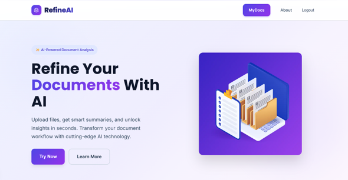
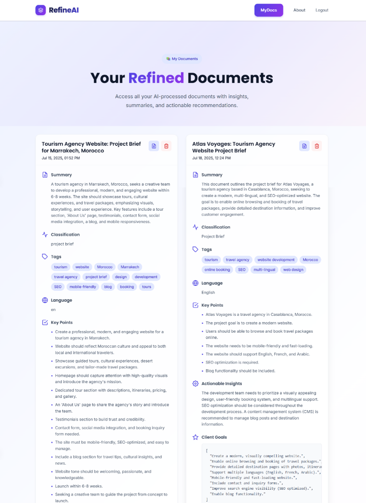

# RefineAI 📄✨
### AI-Powered Document Intelligence & Client Brief Extraction Web Application

[](https://fastapi.tiangolo.com/)
[](https://nextjs.org/)
[](https://react.dev/)
[](https://www.mongodb.com/)
[](https://ai.google.dev/)
[](https://www.python.org/)
[](https://www.typescriptlang.org/)

---

## 📌 Overview

**RefineAI** is an intelligent full-stack web application designed to bridge the gap between unstructured client input and engineering execution. Whether dealing with messy project briefs, scanned technical documents, RFPs, or design requests, RefineAI parses, extracts, cleans, and structures raw files into clear, actionable development blueprints in seconds.

Powered by **Google Gemini 2.0 Flash** and OCR-backed multi-format ingestion, RefineAI extracts executive summaries, bulleted takeaways, language classification, categorized tags, client goals, recommended technology stacks, and effort estimations.

---

## 📸 Screenshots

### 1. Document Upload & Interactive Analysis

*Upload PDFs, Word documents, or images and generate immediate structured intelligence.*

### 2. "MyDocs" Document Workspace & Archive

*Review saved analyses, inspect categorized tags, view actionable insights, examine time estimates, and preview original files.*

---

## ⚡ Core Features

- 📑 **Multi-Format Document Parsing**:
  - **PDF Documents**: Direct text extraction using `pdfplumber` with an automatic page-by-page OCR fallback for scanned/photo PDFs.
  - **Word Documents (`.docx`)**: Structured paragraph extraction via `python-docx`.
  - **Images (`.png`, `.jpg`, `.jpeg`)**: High-accuracy optical character recognition (OCR) via `Tesseract OCR` and `Pillow`.
  - **Plain Text / Code**: Native fallback UTF-8 reader.
- 🧠 **Google Gemini 2.0 Flash Extraction Pipeline**:
  - Automatically synthesizes concise executive summaries.
  - Generates a standalone headline title for easy indexing.
  - Detects document classification and primary language.
  - Extracts client intent, feature goals, and requirements.
  - Formulates recommended tech stacks suited for the project scope.
  - Provides realistic development time estimates.
- 🔒 **Secure User Authentication**:
  - JSON Web Token (JWT) Bearer authentication with bcrypt password hashing.
  - User-specific document isolation in MongoDB.
- 📂 **Personal Document Management ("MyDocs")**:
  - Two-stage save workflow (inspect before saving to account).
  - Quick download or in-browser preview of original uploaded files.
  - One-click document removal and disk cleanup.
- 🎨 **Modern & Responsive UI**:
  - Built with Next.js 15 (App Router), React 19, and modern CSS gradients.
  - Reactive auth state updates across routes.

---

## 🏗️ Architecture & Data Flow

```
[User Browser / Next.js Frontend]
              │
              │  1. Upload Document (Multipart Form Data)
              ▼
    [FastAPI Backend] ──────► [Local Storage (Sanitized UUID Filename)]
              │
              │  2. Text Ingestion & OCR Pipeline
              ├───► Images/Scanned PDFs ───► [Tesseract OCR]
              ├───► Native PDFs         ───► [pdfplumber]
              └───► Word Docs           ───► [python-docx]
              │
              │  3. Formatted JSON Extraction Prompt
              ▼
   [Google Gemini 2.0 Flash]
              │
              │  4. Structured Analysis JSON
              ▼
    [FastAPI Backend] ──────► [Next.js Result Card UI]
              │
              │  5. User clicks "Save to MyDocs"
              ▼
    [MongoDB Database] (Users & Documents Collections)
```

---

## 🛠️ Tech Stack

### Frontend
- **Framework**: [Next.js 15 (App Router)](https://nextjs.org/)
- **UI Library**: [React 19](https://react.dev/)
- **Language**: [TypeScript](https://www.typescriptlang.org/)
- **Styling**: Modern CSS Modules & Tailwind CSS v4

### Backend
- **Framework**: [FastAPI](https://fastapi.tiangolo.com/) (Python 3.9+)
- **ASGI Server**: [Uvicorn](https://www.uvicorn.org/)
- **Database Driver**: [Motor](https://motor.readthedocs.io/) (Async MongoDB driver)
- **Authentication**: `python-jose` (JWT) & `passlib[bcrypt]`
- **OCR & Document Extraction**: `pytesseract`, `Pillow`, `pdfplumber`, `python-docx`
- **AI Integration**: Google Generative AI REST API (`gemini-2.0-flash`)

### Database
- **Engine**: [MongoDB](https://www.mongodb.com/) (Local or MongoDB Atlas)

---

## 🚀 Getting Started

### Prerequisites

Ensure you have the following installed on your machine:
- **Node.js**: v18.0 or later ([Download Node.js](https://nodejs.org/))
- **Python**: v3.9 or later ([Download Python](https://www.python.org/))
- **MongoDB**: Local Community Server running on `localhost:27017` or a MongoDB Atlas URI ([Download MongoDB](https://www.mongodb.com/try/download/community))
- **Tesseract OCR** (for image and scanned PDF extraction):
  - **Windows**: [UB-Mannheim Tesseract Installer](https://github.com/UB-Mannheim/tesseract/wiki) (default installs to `C:\Program Files\Tesseract-OCR\tesseract.exe`)
  - **macOS**: `brew install tesseract`
  - **Linux (Ubuntu/Debian)**: `sudo apt-get install tesseract-ocr`
- **Google Gemini API Key**: Get a free API key from [Google AI Studio](https://aistudio.google.com/).

---

### 1. Clone the Repository

```bash
git clone https://github.com/ReddaOutkida/RefineAI-an-AI-powered-document-intelligence-and-client-brief-extraction-web-application.git
cd RefineAI-an-AI-powered-document-intelligence-and-client-brief-extraction-web-application
```

---

### 2. Backend Setup (FastAPI)

1. **Create and activate a Python virtual environment:**
   ```bash
   # On Windows (PowerShell):
   python -m venv venv
   venv\Scripts\activate

   # On macOS/Linux:
   python3 -m venv venv
   source venv/bin/activate
   ```

2. **Install Python dependencies:**
   ```bash
   pip install -r requirements.txt
   ```

3. **Configure Environment Variables:**
   Copy the example environment file and fill in your credentials:
   ```bash
   cp .env.example .env
   ```

   Edit `.env`:
   ```env
   GEMINI_API_KEY=your_actual_gemini_api_key_here
   GEMINI_API_URL=https://generativelanguage.googleapis.com/v1beta/models/gemini-2.0-flash:generateContent
   SECRET_KEY=your_secure_random_jwt_secret_key
   ALGORITHM=HS256
   ACCESS_TOKEN_EXPIRE_MINUTES=60
   MONGODB_URL=mongodb://localhost:27017
   MONGODB_DB=refineai
   TESSERACT_CMD=C:\Program Files\Tesseract-OCR\tesseract.exe
   ```

4. **Start the FastAPI backend server:**
   ```bash
   uvicorn app.main:app --reload --port 8000
   ```
   The backend will be live at `http://localhost:8000`. You can test endpoints via the interactive Swagger documentation at `http://localhost:8000/docs`.

---

### 3. Frontend Setup (Next.js)

1. Open a new terminal and navigate to the `frontend` directory:
   ```bash
   cd frontend
   ```

2. **Install Node modules:**
   ```bash
   npm install
   ```

3. **Start the Next.js development server:**
   ```bash
   npm run dev
   ```
   The frontend will be live at [http://localhost:3000](http://localhost:3000).

---

## 🔐 Environment Variables Reference

| Variable | Description | Default |
|---|---|---|
| `GEMINI_API_KEY` | Your Google Gemini API Key | *(Required)* |
| `GEMINI_API_URL` | Generative Language endpoint | `.../gemini-2.0-flash:generateContent` |
| `SECRET_KEY` | Secret key used for signing JWT tokens | Change in production |
| `ALGORITHM` | JWT signing algorithm | `HS256` |
| `ACCESS_TOKEN_EXPIRE_MINUTES`| Expiration window for access tokens | `60` |
| `MONGODB_URL` | MongoDB connection string | `mongodb://localhost:27017` |
| `MONGODB_DB` | Database name | `refineai` |
| `TESSERACT_CMD` | Executable path for Tesseract OCR | `C:\Program Files\Tesseract-OCR\tesseract.exe` |

---

## 📡 API Reference

### Authentication
- `POST /auth/signup` – Register a new user account with hashed password.
- `POST /auth/login` – Authenticate user and receive a JWT Bearer token.

### Documents
- `POST /docs/upload-doc` – Upload a file, extract content, and run Gemini analysis.
- `POST /docs/save-doc` – Save an analyzed document into the user's permanent "MyDocs" archive.
- `GET /docs/my-docs` – Retrieve all saved documents belonging to the authenticated user.
- `GET /docs/doc/{doc_id}` – Fetch detailed metadata and AI outputs for a specific document.
- `DELETE /docs/doc/{doc_id}` – Delete document record from database and purge the file from disk.

---

## 🛡️ Security Hardening

This repository includes important security practices:
- **No Hardcoded Secrets**: All API keys, database connection strings, and JWT secret keys are loaded strictly from environment variables.
- **Collision & Traversal Protection**: Uploaded files are assigned cryptographically random UUID prefixes (`uuid4().hex[:8]_filename`) to prevent directory traversal and file overwrites.
- **Git Hygiene**: `.env` and uploaded files in `app/uploads/` are strictly ignored by `.gitignore` to prevent confidential data exposure.

---

## 👨‍💻 Credits & Author

- **Created by**: **Redda Outkida**
- **Internship Project at**: **Acrative** – *"Crafting Digital Futures"*
- **AI Provider**: Google Gemini API

---

## 📄 License

This project is licensed under the MIT License - feel free to use and adapt it for your own projects.
